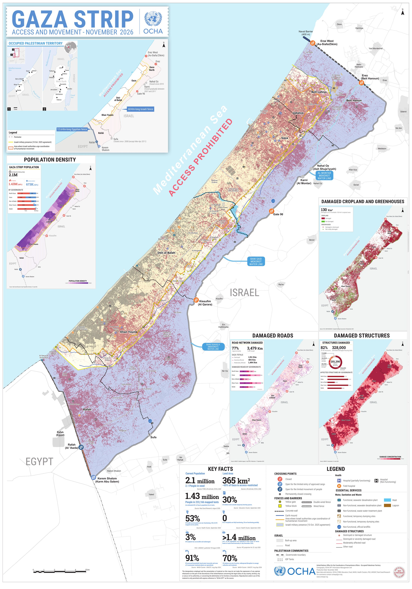

Real Good Research contributed population estimates and satellite-based tent mapping to the United Nations Office for the Coordination of Humanitarian Affairs (OCHA) *Gaza Strip Access and Movement | November 2026* situation update, published on 16 November 2026. The report brings together access, population, damage, and essential-services information to support a shared understanding of humanitarian conditions across the Gaza Strip.

*OCHA’s Gaza Strip Access and Movement poster, November 2026. Select the image to open the original PDF.*

### Our contribution

Our work supports two core parts of the picture presented in the report:

- **Population estimation:** We provide timely, geographically detailed estimates of where people are located across the Gaza Strip, helping partners understand population distribution and displacement in a rapidly changing context.
- **Tent mapping:** We map tents and their changing footprint from recent satellite imagery using a machine learning algorithm developed with partners at the [Algorithmic Governance Foundation](https://algorithmicgovernance.org). These data help chart where people are sheltering and complement other information used to assess humanitarian needs and access constraints.

The OCHA poster used our data to help report that 1.43-million people are estimated to be sheltering in tents (about 68% of the population) and that about 233-thousand tents have been mapped across the Gaza strip. 

Among the report’s key figures, OCHA estimates a current population of 2.1 million people in the Gaza Strip, with 1.43 million people displaced as of the reporting period. The poster indicates that 65 per cent of Gaza’s land area is access-restricted, while 77 per cent of the road network and 82 per cent of structures are damaged. These measures illustrate why timely, geographically detailed information remains essential for planning assistance and assessing where access constraints may compound humanitarian needs.

We are proud of our dedicated team of researchers that are behind the population-estimation and tent-mapping, and we feel privileged to support OCHA and fellow partners who are able to translate this information into on-the-ground action that makes a real difference in people's lives.

The full source product, including its data sources and methodology notes, is available from [OCHA oPt](https://www.ochaopt.org/content/gaza-strip-access-and-movement-november-2026).
